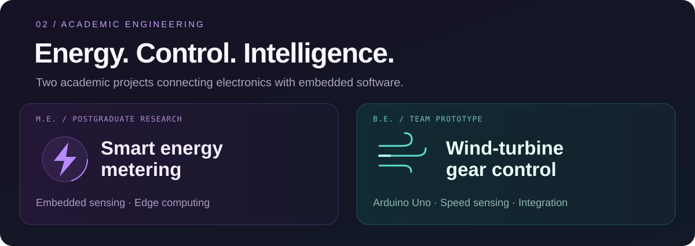
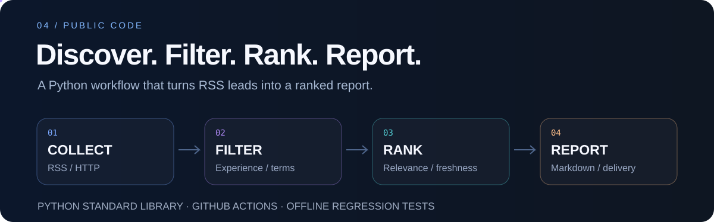

  

  
  
  

  <a href="#academic-projects"><strong>Academic projects</strong></a> &nbsp; / &nbsp;
  <a href="#technical-foundation"><strong>Skills</strong></a> &nbsp; / &nbsp;
  <a href="#education-and-certifications"><strong>Education</strong></a> &nbsp; / &nbsp;
  <a href="#public-code"><strong>Public code</strong></a> &nbsp; / &nbsp;
  <a href="#contact"><strong>Contact</strong></a>

**Embedded systems graduate with a foundation in C, microcontrollers, sensing and control.** My M.E. work focused on smart energy metering with edge computing; my undergraduate team project explored wind-turbine gear control. My public code includes a Python automation pipeline with offline regression tests and GitHub Actions.

| Looking for | Education | Work location |
| --- | --- | --- |
| Graduate / entry-level embedded software and firmware roles | M.E. Embedded System Technologies · CEG, Anna University | **Bengaluru preferred** · Open across India and abroad |

## Academic projects

### ⚡ AI-Enabled Smart Metering with Edge Computing

**M.E. project · Embedded sensing · Energy monitoring · Edge computing**

Explored the use of embedded systems and edge computing for smart energy metering. The detailed research materials remain private while a paper is being prepared.

### 🌬️ Vertical-Axis Wind Turbine with Automatic Gear Control

**B.E. team project · Arduino Uno · Speed sensing · Hardware integration**

Worked on a wind-turbine prototype for telecom-tower applications, bringing together speed sensing, an Arduino Uno-based controller and prototype integration.

## Technical foundation

Technologies and concepts studied or used in project work:

| Area | Foundation |
| --- | --- |
| **C programming** | C, Embedded C, pointers, bitwise operations, data structures and algorithms |
| **Microcontrollers** | ESP32, Arduino Uno, sensor interfacing and digital electronics |
| **Interfaces and messaging** | UART, SPI, I²C, CAN and MQTT |
| **Architecture and systems** | ARM architecture, RTOS concepts and Linux |
| **Development and simulation** | Git, Arduino IDE, Keil µVision, MPLAB IDE, Proteus, MATLAB and LTspice |

## Education and certifications

| Degree | Institution | Completed | CGPA |
| --- | --- | --- | --- |
| **M.E. · Embedded System Technologies** | College of Engineering, Guindy · Anna University | 2026 | **8.32 / 10** |
| **B.E. · Electrical and Electronics Engineering** | Rajalakshmi Engineering College | 2020 | **7.10 / 10** |

**Certifications**

[Introduction to AUTOSAR](https://coursera.org/share/3420ef0491c6f2205df9314dd3b26924) &nbsp; · &nbsp; [Foundations of Cybersecurity](https://coursera.org/share/07af33b775ada85d77478c4cb671296a) &nbsp; · &nbsp; [Play It Safe: Manage Security Risks](https://coursera.org/share/2a4051070028ac4dcc3043d614480c12)

## Public code

### Embedded Systems Job Discovery Automation

A **Python workflow for discovering potentially relevant embedded and firmware job leads**. It collects Google News RSS items, follows source pages when available, removes duplicate URLs, filters and scores entries, and writes a ranked Markdown report.

| What it does | What to inspect |
| --- | --- |
| Parses RSS and normalizes URLs | HTTP handling, XML parsing and deduplication |
| Filters experience ranges and matches complete terms | Regression cases for zero-experience ranges and misleading substring matches |
| Generates reports and supports optional Telegram delivery | Markdown generation and scheduled / manual GitHub Actions |
| Runs offline regression checks | Mocked HTTP fixtures and CI on Python 3.11 / 3.12 |

[**Source code →**](https://github.com/r-pramoth/embedded-systems-job-search/blob/main/scripts/job_search.py) &nbsp; · &nbsp; [Tests](https://github.com/r-pramoth/embedded-systems-job-search/blob/main/tests/test_job_search.py) &nbsp; · &nbsp; [CI checks](https://github.com/r-pramoth/embedded-systems-job-search/actions/workflows/ci.yml) &nbsp; · &nbsp; [Project documentation](https://github.com/r-pramoth/embedded-systems-job-search)

RSS results are leads, not verified vacancies. Eligibility and application status need checking at the original employer source.

## Contact

  <a href="mailto:harishanandh007@gmail.com"><strong>harishanandh007@gmail.com</strong></a> &nbsp; · &nbsp;
  <a href="https://www.linkedin.com/in/pramothraj/"><strong>LinkedIn</strong></a>

