  

  <strong>M.E. Embedded System Technologies · College of Engineering, Guindy · Anna University</strong>

  
  
  

  <a href="#selected-projects"><strong>Projects</strong></a> &nbsp; / &nbsp;
  <a href="#technical-foundation"><strong>Skills</strong></a> &nbsp; / &nbsp;
  <a href="#education"><strong>Education</strong></a> &nbsp; / &nbsp;
  <a href="#certifications"><strong>Certifications</strong></a>

### Where electronics meets code

I am an **Embedded Systems graduate** interested in turning measurements into useful decisions. My academic work covers **smart energy monitoring** and **microcontroller-based wind-turbine control**, supported by a foundation in C, microcontrollers, ARM architecture, RTOS concepts and Linux.

> **Open to graduate / entry-level Embedded Systems, Firmware and Embedded Software roles.**  
> Chennai, India · [Contact by email](mailto:pramothrajeee@gmail.com)

## Selected projects

<table>
<tr>
<td width="50%" valign="top">
<h3>⚡ Smart Energy Monitoring</h3>

<strong>01 / Postgraduate research</strong>

AI-Enabled Smart Metering with Edge Computing.

Exploring embedded systems and edge computing for smart energy monitoring.

 

</td>
<td width="50%" valign="top">
<h3>🌬️ Automatic Gear Control</h3>

<strong>02 / Undergraduate team project</strong>

Wind-energy generation using a vertical-axis wind-turbine prototype for telecom-tower applications.

Arduino Uno-based control, speed sensing and hardware integration.

 

</td>
</tr>
</table>

<strong>About these academic project summaries</strong>

These entries provide public overviews. The reports, detailed research methodology, implementation, source code, datasets, circuit diagrams and evaluation results are not shared here.

### 🐍 Public code / Job Discovery Automation

**Python · RSS · GitHub Actions · Telegram**

An automation project that collects Google News RSS results, enriches and ranks potentially relevant embedded / firmware opportunities, and generates Markdown reports. It supports scheduled or manual runs, results issues, downloadable artifacts and optional Telegram delivery.

[**Explore the repository →**](https://github.com/r-pramoth/embedded-systems-job-search) · [Read the implementation](https://github.com/r-pramoth/embedded-systems-job-search/blob/main/scripts/job_search.py) · [Inspect the workflow](https://github.com/r-pramoth/embedded-systems-job-search/blob/main/.github/workflows/job-search.yml) · [Review regression tests](https://github.com/r-pramoth/embedded-systems-job-search/blob/main/tests/test_job_search.py) · [View CI checks](https://github.com/r-pramoth/embedded-systems-job-search/actions/workflows/ci.yml)

## Technical foundation

  
  
  
  

  
  
  
  

| Area | Technologies and concepts |
| --- | --- |
| Programming | C, Embedded C, pointers, bitwise operations, data structures and algorithms |
| Embedded systems | Microcontrollers, ESP32, Arduino Uno, sensor interfacing, digital electronics |
| Architecture and systems | ARM architecture, RTOS concepts, Linux |
| Communication | UART, SPI, I²C, CAN, MQTT |
| Research interests | Edge computing, intelligent sensing and energy monitoring |

<strong>Expand development and simulation tools</strong>

Git · Arduino IDE · Keil µVision · MPLAB IDE · Proteus · MATLAB · LTspice

## Education

| Degree | Institution | Completed | CGPA |
| --- | --- | --- | --- |
| M.E., Embedded System Technologies | College of Engineering, Guindy · Anna University | 2026 | 8.32 / 10 |
| B.E., Electrical and Electronics Engineering | Rajalakshmi Engineering College | 2020 | 7.10 / 10 |

## Certifications

- [**Introduction to AUTOSAR** — View certificate](https://coursera.org/share/3420ef0491c6f2205df9314dd3b26924)
- [**Foundations of Cybersecurity** — View certificate](https://coursera.org/share/07af33b775ada85d77478c4cb671296a)
- [**Play It Safe: Manage Security Risks** — View certificate](https://coursera.org/share/2a4051070028ac4dcc3043d614480c12)

  

  <a href="mailto:pramothrajeee@gmail.com"><strong>Email</strong></a> &nbsp; · &nbsp;
  <a href="https://www.linkedin.com/in/pramothraj/"><strong>LinkedIn</strong></a> &nbsp; · &nbsp;
  <a href="https://github.com/r-pramoth?tab=repositories"><strong>Public repositories</strong></a>

